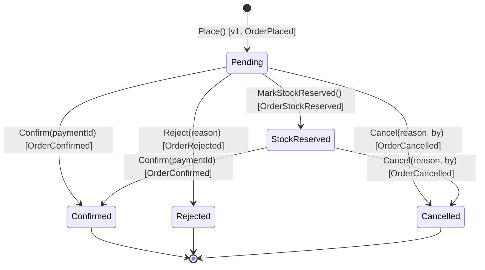
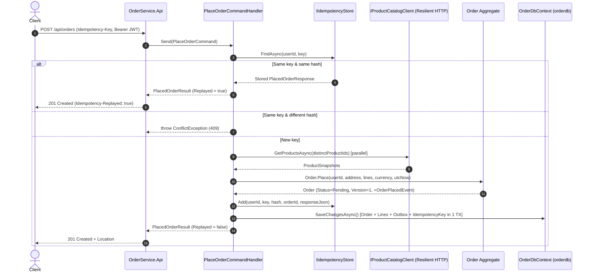
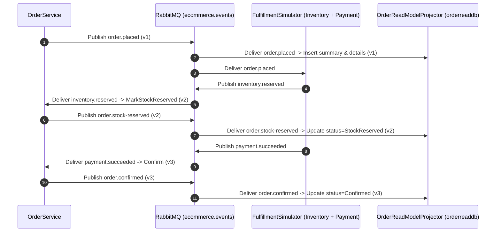
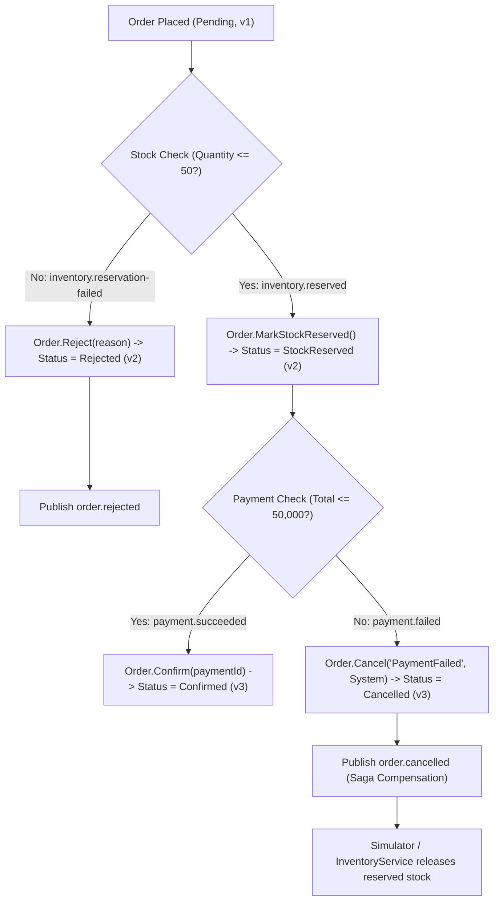
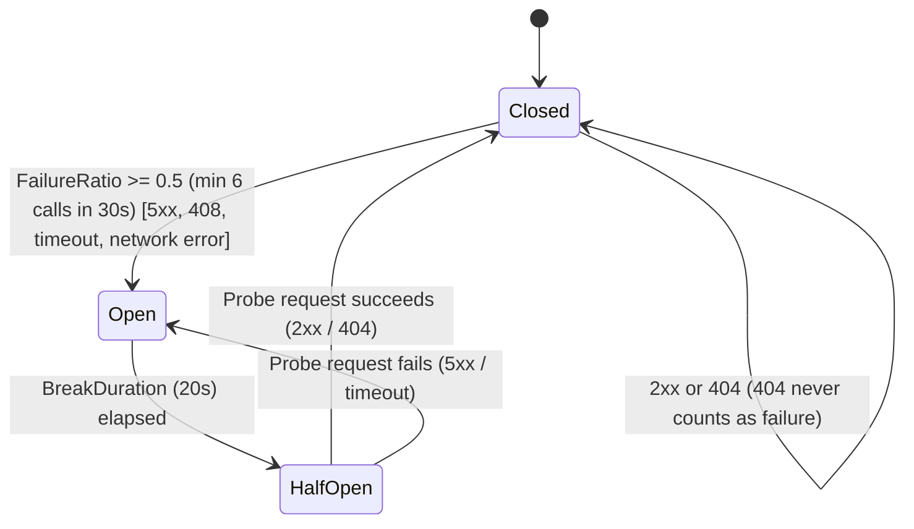

# OrderService — Architecture & DDD Design Document (Phase 0)

## 1. Bounded Context, Responsibilities & Ubiquitous Language

- **Bounded Context**: `Orders`
- **Service Name**: `OrderService` (Service #3 of the E-Commerce Microservices system)
- **What `OrderService` Owns**:
  - Customer orders (`Order` aggregate root) and their line items (`OrderLine` child entity with a snapshot of product name and unit price at order time)
  - Shipping addresses (`Address` value object) and order totals (`Money` value object)
  - Order lifecycle statuses (`Pending`, `StockReserved`, `Confirmed`, `Rejected`, `Cancelled`)
  - Transactional Outbox (`outbox_messages`), Idempotent Consumer Inbox (`inbox_messages`), and HTTP Idempotency Keys (`idempotency_keys`) in `orderdb`
  - Denormalized read-model projections (`order_summaries` and `order_details`) in a separate PostgreSQL database (`orderreaddb`)
- **What `OrderService` Does NOT Own**:
  - Product catalog (`ProductService` owns products; `OrderService` queries `ProductService` over HTTP with resilience and snapshots product name & price)
  - User accounts & credentials (`UserService` owns identity; `OrderService` validates RS256 JWTs using `UserService`'s JWKS endpoint)
  - Inventory stock levels (`InventoryService`) or payment processing (`PaymentService`)
  - `UserId` and `ProductId` are stored as plain `Guid` columns with no cross-service foreign keys.

### What Changes in `OrderService` Compared to `ProductService` & `UserService`
1. **Separate Read Database (`orderreaddb`) & Eventual Consistency**: The write side uses `orderdb` (`OrderDbContext`), while queries read exclusively from a second PostgreSQL database `orderreaddb` (`OrderReadDbContext`) populated asynchronously by `OrderReadModelProjector` from RabbitMQ `order.*` events.
2. **Explicit Integer `Version` Concurrency Token**: Instead of PostgreSQL `xmin`, `Order` maintains an explicit `int Version` (starting at `1` and incrementing by `1` on every applied state transition). It acts as both the EF Core optimistic concurrency token and the monotonic event sequence number for the read-model projector.
3. **Transactional Outbox Before Commit**: Inside `OrderDbContext.SaveChangesAsync`, domain events are converted into `outbox_messages` rows and saved in the **same database transaction** as the `Order` change (and any `inbox_messages` or `idempotency_keys` row). In-process MediatR notifications are published after commit for logging only.
4. **`PlaceOrderCommand` Returns Data**: Because `orderreaddb` is eventually consistent, `POST /api/orders` builds its `201 Created` `PlacedOrderResponse` directly from the `PlaceOrderCommand` result rather than querying the read database.

### Ubiquitous Language Glossary

| Term | Meaning in the `Orders` Context |
|---|---|
| **Order** | Aggregate Root representing a customer's purchase request and its lifecycle state. |
| **OrderLine** | Child entity inside `Order` holding a product snapshot (`ProductId`, `ProductName`, `UnitPrice`), `Quantity`, and `LineTotal`. |
| **Place** | Factory operation that creates a new `Order` in `Pending` status at `Version = 1` and raises `OrderPlacedDomainEvent`. |
| **Confirm** | Transition to `Confirmed` when payment succeeds (`OrderConfirmedDomainEvent`). |
| **Reject** | Transition from `Pending` to `Rejected` when stock reservation fails (`OrderRejectedDomainEvent`). |
| **Cancel** | Transition from `Pending` or `StockReserved` to `Cancelled` by `Customer`, `Admin`, or `System` (`OrderCancelledDomainEvent`). |
| **Money** | Value object combining a non-negative `Amount` (up to 2 decimal places) and a 3-letter uppercase `Currency` (e.g., `EGP`). |
| **Quantity** | Value object representing an integer line quantity between `1` and `100`. |
| **Address** | Value object representing the shipping destination (`RecipientName`, `Street`, `City`, 2-letter ISO `Country`). |

---

## 2. Aggregate Design (`Order` Root + `OrderLine` Child Entity)

### 2.1 `Order` State (`OrderService.Domain/Orders/Order.cs`)

| Property | Type | Mutability | Notes |
|---|---|---|---|
| `Id` | `Guid` (v7) | `protected init` | Generated via `Guid.CreateVersion7(utcNow)` |
| `UserId` | `Guid` | `private set` | Customer's `sub` claim from JWT |
| `Status` | `OrderStatus` | `private set` | `Pending`, `StockReserved`, `Confirmed`, `Rejected`, `Cancelled` |
| `ShippingAddress` | `Address` | `private set` | Value object |
| `Total` | `Money` | `private set` | Sum of all `OrderLine.LineTotal` values |
| `StatusReason` | `string?` | `private set` | Optional reason (max 200 chars) for rejection or cancellation |
| `CancelledBy` | `CancelledBy?` | `private set` | `Customer`, `Admin`, or `System` (when cancelled) |
| `PaymentId` | `string?` | `private set` | Set when confirmed |
| `PlacedAtUtc` | `DateTimeOffset` | `private set` | UTC timestamp when placed |
| `UpdatedAtUtc` | `DateTimeOffset` | `private set` | UTC timestamp of last state transition |
| `Version` | `int` | `private set` | Starts at `1`, increments by `1` on every `Applied` transition; concurrency token |
| `Lines` | `IReadOnlyCollection<OrderLine>` | Backing field `_lines` | 1 to 20 lines, unique `ProductId` per order |

### 2.2 `OrderLine` Child Entity (`OrderService.Domain/Orders/OrderLine.cs`)

| Property | Type | Notes |
|---|---|---|
| `Id` | `Guid` (v7) | Unique line identifier |
| `OrderId` | `Guid` | Parent `Order.Id` |
| `ProductId` | `Guid` | Snapshot of product ID |
| `ProductName` | `string` | Trimmed, required, max 200 chars |
| `UnitPrice` | `Money` | Snapshot of product price at order time (`Amount > 0`) |
| `Quantity` | `Quantity` | Value object (`1..100`) |
| `LineTotal` | `Money` | `UnitPrice.Multiply(Quantity.Value)` |

### 2.3 Order Status State Machine & Transition Table

Every transition method returns `TransitionResult` (`Applied`, `NoChange`, `NotAllowed`). Only `Applied` mutates state, increments `Version`, updates `UpdatedAtUtc`, and raises a domain event:

| Current Status | `MarkStockReserved` | `Confirm(paymentId)` | `Reject(reason)` | `Cancel(reason, by)` |
|---|---|---|---|---|
| **`Pending`** | `Applied` $\rightarrow$ `StockReserved` | `Applied` $\rightarrow$ `Confirmed` | `Applied` $\rightarrow$ `Rejected` | `Applied` $\rightarrow$ `Cancelled` |
| **`StockReserved`** | `NoChange` | `Applied` $\rightarrow$ `Confirmed` | `NotAllowed` | `Applied` $\rightarrow$ `Cancelled` |
| **`Confirmed`** | `NoChange` | `NoChange` | `NotAllowed` | `NotAllowed` |
| **`Rejected`** | `NotAllowed` | `NotAllowed` | `NoChange` | `NotAllowed` |
| **`Cancelled`** | `NotAllowed` | `NotAllowed` | `NotAllowed` | `NoChange` |

### 2.4 Domain Invariants Table

| Rule | Where Checked | Error Code (`DomainException`) |
|---|---|---|
| `UserId` must not be `Guid.Empty` | `Order.Place` | `order.invalid_user_id` |
| Order must have between 1 and 20 lines | `Order.Place` | `order.invalid_line_count` |
| No two lines may have the same `ProductId` | `Order.Place` | `order.duplicate_product` |
| All line prices must match order currency | `Order.Place` / `Money.Add` | `order.currency_mismatch` |
| Order total must be strictly greater than `0` | `Order.Place` | `order.invalid_total` |
| `ProductName` required, trimmed, $\le 200$ chars | `OrderLine` | `order.invalid_product_name` |
| `Money.Amount >= 0`, $\le 2$ decimals, 3-letter uppercase `Currency` | `Money.Create` | `order.invalid_money` |
| `Quantity.Value` between `1` and `100` | `Quantity.Create` | `order.invalid_quantity` |
| `Address` fields required, within max lengths, 2-letter uppercase `Country` | `Address.Create` | `order.invalid_address` |
| Customer/Admin cannot cancel a `Confirmed` or `Rejected` order | `CancelOrderCommandHandler` | `order.cannot_cancel` |

> **Currency Assumption**: `ProductService` returns a decimal `price` without a currency field. `OrderService` assumes `ProductService` prices are denominated in `Orders:DefaultCurrency` (default `"EGP"`).

---

## 3. CQRS with Two Databases (`orderdb` and `orderreaddb`)

### 3.1 Write Database Schema (`orderdb` — `OrderDbContext`)

1. **`orders`**:
   - `id` (`uuid`, PK), `user_id` (`uuid`, indexed), `status` (`varchar(32)`), `status_reason` (`varchar(200)` nullable), `cancelled_by` (`varchar(32)` nullable), `payment_id` (`varchar(128)` nullable), `recipient_name` (`varchar(100)`), `street` (`varchar(200)`), `city` (`varchar(100)`), `country` (`varchar(2)`), `total_amount` (`numeric(18,2)`), `currency` (`varchar(3)`), `placed_at_utc` (`timestamptz`), `updated_at_utc` (`timestamptz`), `version` (`integer`, concurrency token).
2. **`order_lines`**:
   - `id` (`uuid`, PK), `order_id` (`uuid`, FK $\rightarrow$ `orders.id` `ON DELETE CASCADE`), `product_id` (`uuid`), `product_name` (`varchar(200)`), `unit_price` (`numeric(18,2)`), `currency` (`varchar(3)`), `quantity` (`integer`), `line_total` (`numeric(18,2)`).
   - Unique index `IX_order_lines_order_id_product_id` on `(order_id, product_id)`.
3. **`outbox_messages`**:
   - `id` (`uuid`, PK), `order_id` (`uuid`), `routing_key` (`varchar(128)`), `payload_json` (`jsonb`), `correlation_id` (`varchar(64)` nullable), `occurred_on_utc` (`timestamptz`), `processed_on_utc` (`timestamptz` nullable), `attempts` (`integer`, default `0`), `next_retry_at_utc` (`timestamptz` nullable), `last_error` (`varchar(1000)` nullable), `is_dead` (`boolean`, default `false`).
   - Index `IX_outbox_messages_unsent` on `(processed_on_utc, is_dead, next_retry_at_utc, id)` for fast polling with `FOR UPDATE SKIP LOCKED`.
4. **`inbox_messages`**:
   - `message_id` (`varchar(128)`), `consumer` (`varchar(128)`), `processed_on_utc` (`timestamptz`).
   - Composite PK `(message_id, consumer)`.
5. **`idempotency_keys`**:
   - `user_id` (`uuid`), `key` (`varchar(64)`), `request_hash` (`varchar(128)`), `order_id` (`uuid`), `response_json` (`jsonb`), `created_at_utc` (`timestamptz`).
   - Composite PK `(user_id, key)`.

### 3.2 Read Database Schema (`orderreaddb` — `OrderReadDbContext`)

1. **`order_summaries`**:
   - `order_id` (`uuid`, PK), `user_id` (`uuid`), `status` (`varchar(32)`), `total` (`numeric(18,2)`), `currency` (`varchar(3)`), `item_count` (`integer`), `placed_at_utc` (`timestamptz`), `updated_at_utc` (`timestamptz`), `version` (`integer`).
   - Indexes: `IX_order_summaries_user_placed` on `(user_id, placed_at_utc DESC)` and `IX_order_summaries_status_placed` on `(status, placed_at_utc DESC)`.
2. **`order_details`**:
   - `order_id` (`uuid`, PK), `user_id` (`uuid`), `status` (`varchar(32)`), `total` (`numeric(18,2)`), `currency` (`varchar(3)`), `placed_at_utc` (`timestamptz`), `updated_at_utc` (`timestamptz`), `version` (`integer`), `items_json` (`jsonb`), `shipping_address_json` (`jsonb`), `history_json` (`jsonb`).

### 3.3 Eventual Consistency Rules
- The read database (`orderreaddb`) is updated asynchronously after `OutboxPublisherService` publishes `order.*` to RabbitMQ and `OrderReadModelConsumer` invokes `OrderReadModelProjector` (typically within $< 1$ second).
- `POST /api/orders` returns `PlacedOrderResponse` directly from the write command result so the caller immediately receives the created order.
- Calling `GET /api/orders/{id}` immediately after `POST /api/orders` may return `404 Not Found` for a few milliseconds until the projection completes; clients should retry on `404`.
- `OrderReadModelProjector` enforces `event.Version > stored.Version`: duplicate or older events are ignored; if a non-`order.placed` event arrives before `order.placed` has been projected, the projector throws `InvalidOperationException("Order read model row not found yet")` so the consumer retries with backoff.

---

## 4. Command, Query & Event Catalog

| Message | Type | Input | Output | Endpoint / Trigger | Authorization |
|---|---|---|---|---|---|
| `PlaceOrderCommand` | Command | `UserId, IdempotencyKey, Items, ShippingAddress` | `PlacedOrderResult` | `POST /api/orders` | Authenticated |
| `CancelOrderCommand` | Command | `OrderId, CallerUserId, CallerIsAdmin, Reason?` | `Unit` | `POST /api/orders/{id}/cancel` | Authenticated (Owner or Admin) |
| `ExpireOrderCommand` | Command | `OrderId` | `Unit` | `OrderExpirationService` | Internal Background |
| `RecordStockReservedCommand` | Inbox Command | `MessageId, OrderId` | `Unit` | RabbitMQ `inventory.reserved` | Internal Consumer |
| `RecordStockReservationFailedCommand` | Inbox Command | `MessageId, OrderId, Reason` | `Unit` | RabbitMQ `inventory.reservation-failed` | Internal Consumer |
| `RecordPaymentSucceededCommand` | Inbox Command | `MessageId, OrderId, PaymentId` | `Unit` | RabbitMQ `payment.succeeded` | Internal Consumer |
| `RecordPaymentFailedCommand` | Inbox Command | `MessageId, OrderId, Reason` | `Unit` | RabbitMQ `payment.failed` | Internal Consumer |
| `GetOrderByIdQuery` | Query | `OrderId, CallerUserId, CallerIsAdmin` | `OrderDetailsResponse` | `GET /api/orders/{id}` | Authenticated (Owner or Admin) |
| `ListMyOrdersQuery` | Query | `UserId, Status?, From?, To?, SortBy, SortDir, Page, PageSize` | `PagedResponse<OrderSummaryResponse>` | `GET /api/orders/my` | Authenticated |
| `ListOrdersQuery` | Query | `UserId?, Status?, From?, To?, SortBy, SortDir, Page, PageSize` | `PagedResponse<OrderSummaryResponse>` | `GET /api/orders` | `AdminOnly` |

---

## 5. Architecture & Sequence Diagrams

### 5.1 `PlaceOrder` Request Flow (Idempotency + Product Calls + Outbox Commit)

### 5.2 Saga Choreography — Happy Path

### 5.3 Saga Failure Paths & Compensation

### 5.4 Circuit Breaker State Machine (`ProductCatalogHttpClient`)

---

## 6. Resilience Settings & Timeout Budget

### 6.1 Resilience Pipeline (`Resilience:ProductService`)

| Setting | Default | Purpose |
|---|---|---|
| `TotalTimeoutMs` | `8000` (8 s) | Outer cap across all retries for a `ProductService` call |
| `MaxRetryAttempts` | `2` | Up to 2 retries (3 total attempts) for `GET` requests only |
| `RetryBaseDelayMs` | `200` | Exponential backoff base delay with jitter |
| `CircuitFailureRatio` | `0.5` | Opens when $\ge 50\%$ of requests fail |
| `CircuitMinimumThroughput` | `6` | Minimum calls in sampling window before breaker can trip |
| `CircuitSamplingDurationSeconds` | `30` | Rolling sampling window |
| `CircuitBreakDurationSeconds` | `20` | Open duration; returned in `Retry-After` header on `503` |
| `AttemptTimeoutMs` | `2000` (2 s) | Inner per-attempt timeout |

### 6.2 Timeout Budget Table (Every Inner Timeout $<$ Outer Timeout)

| Layer / Operation | Timeout | What Happens on Expiry |
|---|---|---|
| **Inbound HTTP API Request** | `15 s` | ASP.NET Core request timeout $\rightarrow$ `504 Gateway Timeout` (`ProblemDetails`) |
| **Database Command (`orderdb` / `orderreaddb`)** | `10 s` | EF Core command timeout |
| **`PlaceOrder` Calls to `ProductService` (Total)** | `8 s` | `DependencyTimeoutException` $\rightarrow$ `504 Gateway Timeout` |
| **`PlaceOrder` Single Attempt to `ProductService`** | `2 s` | Retried up to 2 times inside the 8 s total budget |
| **RabbitMQ Publisher Confirm** | `5 s` | Outbox batch stops, increments `attempts`, retries with backoff |
| **JWKS Fetch (`JwksSigningKeyProvider`)** | `2 s` / attempt, `5 s` total | Falls back to last cached keys (up to 24 hours) |
| **RabbitMQ Consumer Message Handler** | `30 s` | Counts as handler attempt failure; retried up to 5 times then sent to DLQ |
| **Business Order Expiration (`Orders:PendingTimeoutMinutes`)** | `15 min` | `OrderExpirationService` cancels stale `Pending`/`StockReserved` orders (`reason: "Timeout"`, `System`) |

---

## 7. Ten Key Architectural Decisions

1. **Separate Read Database (`orderreaddb`) with Eventual Consistency**: Decouples complex list/detail queries and JSONB history projections from the transactional write tables (`orderdb`).
2. **Transactional Outbox Pattern**: Saves `outbox_messages` in the same PostgreSQL transaction as `Order` changes so an order state change and its integration event are never out of sync.
3. **Idempotent Consumer Inbox (`inbox_messages`)**: Tracks `(message_id, consumer)` in the same transaction as the saga command handler so duplicate RabbitMQ deliveries (at-least-once delivery) are safely skipped.
4. **Raw `RabbitMQ.Client` 7.x Instead of a Bus Framework**: Explicitly manages exchanges, queues, DLQs, publisher confirms, and manual `BasicAckAsync`/`BasicNackAsync` for transparency and zero magic.
5. **Full Snapshot in `order.placed` + Monotonic `Version` on All Events**: Lets `OrderReadModelProjector` build and update `orderreaddb` without querying `orderdb` and ignore out-of-order or duplicate events (`event.Version <= stored.Version`).
6. **Explicit `int Version` as Optimistic Concurrency Token**: Serves both EF Core concurrency detection (`409 Conflict`) and read-model event ordering.
7. **`PlaceOrderCommand` Returns `PlacedOrderResult`**: Avoids reading from the eventually-consistent `orderreaddb` during `POST /api/orders`.
8. **No Automatic HTTP Retry on `POST`, Protected by `Idempotency-Key`**: Prevents accidental duplicate side effects while allowing clients to safely retry `POST /api/orders` with the same `Idempotency-Key`.
9. **No Fallback for Product Lookups**: An order cannot be placed with a guessed price; `ProductService` unavailability returns `503`/`504` (`Retry-After`), whereas a local product cache populated by events is noted as a future evolution.
10. **Readiness Probe Ignores `ProductService`**: `/health/ready` checks `orderdb`, `orderreaddb`, and RabbitMQ connectivity (plus `Degraded` if an unsent outbox message is older than 60 s) so a `ProductService` outage does not cause orchestrators to restart `OrderService` or drop read/cancel traffic.

---

## 8. Known Limitations

- **Payment Arriving for an Already Cancelled/Rejected Order**: If `payment.succeeded` arrives after an order was already `Cancelled` (e.g., by timeout) or `Rejected`, `Order.Confirm` returns `TransitionResult.NotAllowed` and `RecordPaymentSucceededCommandHandler` logs a `Warning` (`"payment received for a closed order, needs refund"`). In a production system, this would publish a `payment.refund-requested` event.
- **Price Snapshot at Order Time**: Product prices are snapshotted when `PlaceOrder` calls `ProductService`; subsequent catalog price changes do not affect existing orders.
- **Local Classic Durable Queues**: Local Docker Compose uses classic durable queues; production RabbitMQ clusters typically use Quorum Queues (`x-queue-type: quorum`).
