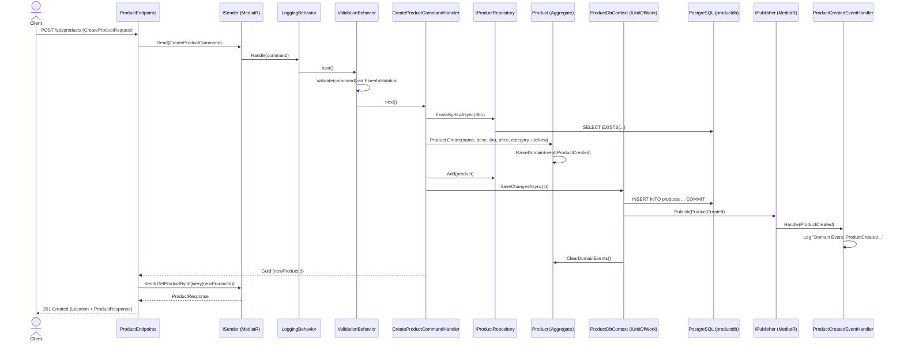
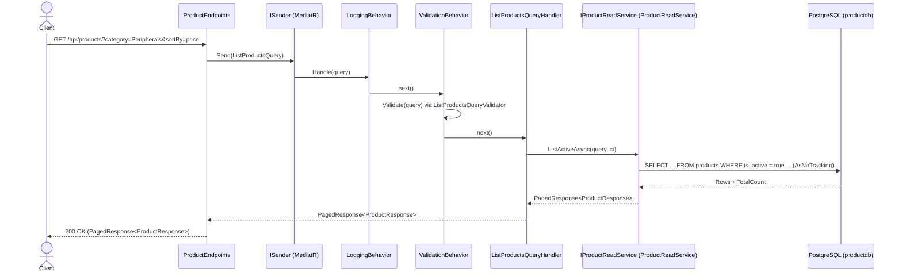

# ProductService — DDD, CQRS & MediatR Design Document

## 1. Service Responsibilities, Bounded Context & Ubiquitous Language

### Bounded Context: Catalog
**ProductService** is an independent microservice that owns the **Product Catalog** bounded context.

- **What ProductService Owns**: Product master data (`Id`, `Name`, `Description`, `Sku`, `Price`, `Category`, `IsActive`, `CreatedAtUtc`, `UpdatedAtUtc`) stored in its private PostgreSQL 17 database (`productdb`).
- **What ProductService Does NOT Own**: Stock quantities (`InventoryService`), users (`UserService`), orders (`OrderService`), or payments (`PaymentService`). Other services refer to a product by its `Id` only and call `ProductService` over HTTP.

### Glossary of the Ubiquitous Language
We use these exact terms in domain code, application handlers, API contracts, and documentation:

| Term | Meaning in the Catalog Bounded Context |
| :--- | :--- |
| **Product** | The aggregate root representing an item in the catalog that can be sold when active. |
| **Sku** | Stock Keeping Unit — a value object representing a unique, immutable, uppercase product code (max 50 chars). |
| **Price** | A value object representing the monetary price of a product (`> 0`, at most 2 decimal places). |
| **Category** | The catalog classification of a product (e.g., `"Peripherals"`, `"Monitors"`), max 100 chars. |
| **UpdateDetails** | Changing a product's descriptive attributes (`Name`, `Description`, `Category`). |
| **ChangePrice** | Changing a product's `Price` to a new value (raises `ProductPriceChanged` if different). |
| **Deactivate** | Making a product inactive (`IsActive = false`) so it is hidden from buyers. In domain and application code we always say **Deactivate**, never "Delete" (even though the HTTP verb is `DELETE`). |
| **Activate** | Making an inactive product active again (`IsActive = true`). |

---

## 2. Aggregate Design (`Product`)

### Why `Product` is the Aggregate Root
In DDD, an **Aggregate Root** is the gatekeeper of consistency for a cluster of domain objects. Outside code can only load and save the root (`Product`), never its internal parts directly. Every invariant (such as "an inactive product cannot change its price or details") is enforced inside `Product` methods before any state changes.

### Aggregate Boundary
- **One `Product` = One Aggregate = One Transactional Consistency Boundary.**
- One command modifies **at most one** `Product` aggregate and commits once via `IUnitOfWork.SaveChangesAsync`.
- Stock and orders belong to separate aggregates in other microservices and reference `Product` by `Id` only.

### State (All Setters Private)
| Property | C# Type | Notes |
| :--- | :--- | :--- |
| `Id` | `Guid` | Created via `Guid.CreateVersion7(utcNow)`. |
| `Name` | `string` | Required, trimmed, max 200 characters. |
| `Description` | `string?` | Optional, trimmed, max 2000 characters. |
| `Sku` | `Sku` (Value Object) | Required, trimmed, uppercase, max 50 characters, immutable after creation. |
| `Price` | `Price` (Value Object) | Required, `> 0`, max 2 decimal places. |
| `Category` | `string` | Required, trimmed, max 100 characters. |
| `IsActive` | `bool` | `true` on creation; changed only by `Deactivate` and `Activate`. |
| `CreatedAtUtc` | `DateTimeOffset` | Passed into `Product.Create(..., utcNow)`. |
| `UpdatedAtUtc` | `DateTimeOffset` | Updated on every state change using the caller-supplied `utcNow`. |

### Behaviors (Public Methods on `Product`)
1. `static Product Create(string name, string? description, Sku sku, Price price, string category, DateTimeOffset utcNow)`
   - Validates inputs, creates the `Product` with `IsActive = true`, and raises `ProductCreated`.
2. `void UpdateDetails(string name, string? description, string category, DateTimeOffset utcNow)`
   - Rejects if `!IsActive` (`product.inactive`). Validates and updates `Name`, `Description`, `Category`, and `UpdatedAtUtc`.
3. `void ChangePrice(Price newPrice, DateTimeOffset utcNow)`
   - Rejects if `!IsActive` (`product.inactive`). If `Price == newPrice`, does nothing. Otherwise updates `Price`, `UpdatedAtUtc`, and raises `ProductPriceChanged`.
4. `void Deactivate(DateTimeOffset utcNow)`
   - Idempotent: if already `!IsActive`, does nothing. Otherwise sets `IsActive = false`, updates `UpdatedAtUtc`, and raises `ProductDeactivated`.
5. `void Activate(DateTimeOffset utcNow)`
   - Idempotent: if already `IsActive`, does nothing. Otherwise sets `IsActive = true`, updates `UpdatedAtUtc`, and raises `ProductActivated`.

### Invariants Table

| Rule / Invariant | Where Checked | Error Code (`DomainException`) |
| :--- | :--- | :--- |
| `Name` is not empty or whitespace | `Product` + FluentValidation | `product.name_required` |
| `Name` length <= 200 after trim | `Product` + FluentValidation | `product.name_too_long` |
| `Description` length <= 2000 after trim | `Product` + FluentValidation | `product.description_too_long` |
| `Category` is not empty or whitespace | `Product` + FluentValidation | `product.category_required` |
| `Category` length <= 100 after trim | `Product` + FluentValidation | `product.category_too_long` |
| `Sku` is not empty or whitespace | `Sku.Create` + FluentValidation | `sku.empty` |
| `Sku` length <= 50 after trim | `Sku.Create` + FluentValidation | `sku.too_long` |
| `Price` > 0 | `Price.Create` + FluentValidation | `price.not_positive` |
| `Price` has at most 2 decimal places (no silent rounding) | `Price.Create` + FluentValidation | `price.too_many_decimals` |
| Inactive product cannot be modified (`UpdateDetails`, `ChangePrice`) | `Product.EnsureActive()` | `product.inactive` |
| `Sku` is unique across all products | `CreateProductCommandHandler` + DB Unique Index (`23505`) | `ConflictException` (HTTP 409) |

---

## 3. Value Objects & Domain Events

### Value Objects (`ProductService.Domain/Products/`)
Implemented as `sealed record` types with a private constructor and a `static Create(...)` factory method:
1. **`Sku`**:
   - Holds `string Value`.
   - Trims input and converts to `ToUpperInvariant()`.
   - Throws `DomainException` with code `sku.empty` if blank, or `sku.too_long` if length > 50.
2. **`Price`**:
   - Holds `decimal Amount`.
   - Throws `DomainException` with code `price.not_positive` if `<= 0`.
   - Checks ` decimal.Round(amount, 2) != amount ` — throws `DomainException` with code `price.too_many_decimals` if more than 2 decimal places exist (never rounds silently).

### Domain Events (`ProductService.Domain/Products/Events/`)
Past-tense immutable records implementing `IDomainEvent : INotification`:
1. `ProductCreated(Guid ProductId, string Sku, decimal Price, DateTimeOffset OccurredOnUtc)`
2. `ProductPriceChanged(Guid ProductId, decimal OldPrice, decimal NewPrice, DateTimeOffset OccurredOnUtc)`
3. `ProductDeactivated(Guid ProductId, DateTimeOffset OccurredOnUtc)`
4. `ProductActivated(Guid ProductId, DateTimeOffset OccurredOnUtc)`

---

## 4. Database Schema (`productdb` -> `products`)

| Column | PostgreSQL Type | Nullable | Default | Constraints & Mapping |
| :--- | :--- | :--- | :--- | :--- |
| `id` | `uuid` | `NOT NULL` | — | Primary Key (`PK_products`), `ValueGeneratedNever()` |
| `name` | `character varying(200)` | `NOT NULL` | — | Max length 200 |
| `description` | `character varying(2000)` | `NULL` | — | Max length 2000 |
| `sku` | `character varying(50)` | `NOT NULL` | — | Mapped from `Sku.Value` (`ComplexProperty` / `OwnsOne`), Unique Index |
| `price` | `numeric(18,2)` | `NOT NULL` | — | Mapped from `Price.Amount` (`ComplexProperty` / `OwnsOne`), Check `price > 0` |
| `category` | `character varying(100)` | `NOT NULL` | — | Max length 100, Non-unique Index |
| `is_active` | `boolean` | `NOT NULL` | `true` | Active flag |
| `created_at_utc` | `timestamp with time zone` | `NOT NULL` | — | UTC timestamp |
| `updated_at_utc` | `timestamp with time zone` | `NOT NULL` | — | UTC timestamp |
| `xmin` | `xid` (system column) | `NOT NULL` | Postgres internal | **Optimistic concurrency token** (`IsRowVersion()`) |

**Indexes & Constraints:**
- `PK_products` on `(id)`
- `IX_products_sku` UNIQUE btree index on `(sku)`
- `IX_products_category` btree index on `(category)`
- `CK_products_price_positive` CHECK constraint `(price > 0)`
- `DomainEvents` list on `AggregateRoot` is ignored by EF Core (`builder.Ignore(p => p.DomainEvents)`).

---

## 5. Command and Query Catalog (CQRS)

| Message | Type | Input Fields | Output | Validator Rules (FluentValidation) | Aggregate / Service Called | Possible Errors | HTTP Endpoint |
| :--- | :--- | :--- | :--- | :--- | :--- | :--- | :--- |
| **`CreateProductCommand`** | Command | `Name`, `Description`, `Sku`, `Price`, `Category` | `Guid` (New Product Id) | `Name` required <=200; `Description` <=2000; `Sku` required <=50; `Price` >0 & <=2 decimals; `Category` required <=100 | `IProductRepository.ExistsBySkuAsync`, `Product.Create(...)`, `IProductRepository.Add`, `IUnitOfWork.SaveChangesAsync` | `400` Validation, `409` Duplicate SKU, `422` Domain rule | `POST /api/products` |
| **`UpdateProductCommand`** | Command | `Id`, `Name`, `Description`, `Price`, `Category` | `Unit` (void) | `Id` not empty; `Name` required <=200; `Description` <=2000; `Price` >0 & <=2 decimals; `Category` required <=100 | `IProductRepository.GetByIdAsync`, `product.UpdateDetails(...)`, `product.ChangePrice(...)`, `IUnitOfWork.SaveChangesAsync` | `400` Validation, `404` Not found, `409` Concurrency conflict, `422` Inactive product (`product.inactive`) | `PUT /api/products/{id}` |
| **`DeactivateProductCommand`** | Command | `Id` | `Unit` (void) | `Id` not empty | `IProductRepository.GetByIdAsync`, `product.Deactivate(utcNow)`, `IUnitOfWork.SaveChangesAsync` | `400` Validation, `404` Not found | `DELETE /api/products/{id}` |
| **`ActivateProductCommand`** | Command | `Id` | `Unit` (void) | `Id` not empty | `IProductRepository.GetByIdAsync`, `product.Activate(utcNow)`, `IUnitOfWork.SaveChangesAsync` | `400` Validation, `404` Not found | `POST /api/products/{id}/activate` |
| **`GetProductByIdQuery`** | Query | `Id` | `ProductResponse` | `Id` not empty | `IProductReadService.GetActiveByIdAsync(id)` | `404` Not found (or inactive) | `GET /api/products/{id}` |
| **`ListProductsQuery`** | Query | `Search`, `Category`, `MinPrice`, `MaxPrice`, `SortBy`, `SortDir`, `Page`, `PageSize` | `PagedResponse<ProductResponse>` | `Page >= 1`; `PageSize` 1..100; `MinPrice >= 0`; `MaxPrice >= MinPrice`; `SortBy` in `name\|price\|createdAt`; `SortDir` in `asc\|desc` | `IProductReadService.ListActiveAsync(query)` | `400` Validation | `GET /api/products` |

---

## 6. MediatR Pipeline Order & Sequence Diagrams

### Pipeline Order (Outer to Inner)
1. **`LoggingBehavior<TRequest, TResponse>`** — Logs the request type name before execution and the elapsed milliseconds after completion (never logs request bodies).
2. **`ValidationBehavior<TRequest, TResponse>`** — Executes all registered `IValidator<TRequest>` instances. If any validation failures exist, throws `FluentValidation.ValidationException` (mapped to HTTP `400`) and short-circuits before the handler runs.
3. **`RequestHandler`** (`ICommandHandler` or `IQueryHandler`) — Executes the use case.

### Sequence Diagram 1: Write Flow (`POST /api/products`)



### Sequence Diagram 2: Read Flow (`GET /api/products`)



---

## 7. API Contract & JSON Examples

| Method | Path | Description | Success | Error Statuses |
| :--- | :--- | :--- | :--- | :--- |
| `POST` | `/api/products` | Create a new product | `201 Created` + `Location` + `ProductResponse` | `400`, `409` (SKU exists), `422` |
| `GET` | `/api/products/{id}` | Get an active product by ID | `200 OK` + `ProductResponse` | `404` (missing or inactive) |
| `GET` | `/api/products` | List active products (filter, sort, page) | `200 OK` + `PagedResponse<ProductResponse>` | `400` |
| `PUT` | `/api/products/{id}` | Update name, description, price, category | `200 OK` + `ProductResponse` | `400`, `404`, `409` (concurrency), `422` (inactive) |
| `DELETE` | `/api/products/{id}` | Deactivate product (`IsActive = false`, idempotent) | `204 No Content` | `404` |
| `POST` | `/api/products/{id}/activate` | Activate product (`IsActive = true`, idempotent) | `204 No Content` | `404` |
| `GET` | `/health/live` | Liveness check | `200 OK` | — |
| `GET` | `/health/ready` | Readiness check (PostgreSQL reachable) | `200 OK` | `503` |

### Example Error Responses (RFC 7807 `ProblemDetails`)

#### `400 Bad Request` (`ValidationException`)
```json
{
  "type": "https://tools.ietf.org/html/rfc9110#section-15.5.1",
  "title": "Validation Failed",
  "status": 400,
  "detail": "One or more validation errors occurred.",
  "instance": "/api/products",
  "errors": {
    "Price": ["Price must have at most 2 decimal places."]
  }
}
```

#### `422 Unprocessable Entity` (`DomainException` — e.g., updating an inactive product)
```json
{
  "type": "https://tools.ietf.org/html/rfc9110#section-15.5.21",
  "title": "Domain Rule Violation",
  "status": 422,
  "detail": "Cannot modify an inactive product. Activate it first.",
  "instance": "/api/products/0196ed70-5a2c-7b6a-9870-123456789abc",
  "code": "product.inactive"
}
```

---

## 8. Folder Structure, Reference Rules, Configuration & Packages

### Folder Structure
```text
ECommerce/ (D:\MicroServess)
  docker-compose.yml
  infra/postgres/init.sql
  README.md
  services/ProductService/
    ProductService.slnx
    Directory.Build.props, Dockerfile, .dockerignore
    docs/design.md, docs/openapi.yaml
    src/ProductService.Domain/
        Abstractions/   Entity.cs, AggregateRoot.cs, IDomainEvent.cs, DomainException.cs, IUnitOfWork.cs
        Products/       Product.cs, Sku.cs, Price.cs, IProductRepository.cs
                        Events/ProductCreated.cs, ProductPriceChanged.cs, ProductDeactivated.cs, ProductActivated.cs
    src/ProductService.Application/
        Abstractions/   ICommand.cs, IQuery.cs, ICommandHandler.cs, IQueryHandler.cs, IProductReadService.cs
        Behaviors/      LoggingBehavior.cs, ValidationBehavior.cs
        Exceptions/     NotFoundException.cs, ConflictException.cs
        Products/
            ProductResponse.cs, PagedResponse.cs
            Commands/CreateProduct/, UpdateProduct/, DeactivateProduct/, ActivateProduct/
            Queries/GetProductById/, ListProducts/
            EventHandlers/ProductDomainEventHandlers.cs
    src/ProductService.Infrastructure/
        Persistence/    ProductDbContext.cs, ProductRepository.cs, ProductReadService.cs, ProductDbSeeder.cs
                        Configurations/ProductConfiguration.cs
                        Migrations/
    src/ProductService.Api/
        Program.cs, Endpoints/ProductEndpoints.cs
        Middleware/GlobalExceptionHandler.cs, CorrelationIdMiddleware.cs
    tests/ProductService.UnitTests/          (Domain/, Application/, Architecture/)
    tests/ProductService.IntegrationTests/
```

### Reference Rules
- `Api` -> `Application` + `Infrastructure`
- `Infrastructure` -> `Application` + `Domain`
- `Application` -> `Domain`
- `Domain` -> **nothing**

### Configuration
- **Ports**: API on `http://localhost:5001` (`launchSettings.json`), PostgreSQL on `localhost:5432`. In Docker: container port `8080` published to host `5001:8080`.
- **Connection String**: `ConnectionStrings:ProductDb` in `appsettings.Development.json` (`Host=localhost;Port=5432;Database=productdb;Username=postgres;Password=postgres`) and `ConnectionStrings__ProductDb` in Docker Compose (`Host=postgres;...`).

### NuGet Packages per Project
| Project | NuGet Packages |
| :--- | :--- |
| `ProductService.Domain` | `MediatR.Contracts` (2.0.1 — the only package allowed in Domain) |
| `ProductService.Application` | `MediatR` (**12.5.0** pinned), `FluentValidation`, `FluentValidation.DependencyInjectionExtensions`, `Microsoft.Extensions.Logging.Abstractions` |
| `ProductService.Infrastructure` | `Microsoft.EntityFrameworkCore`, `Npgsql.EntityFrameworkCore.PostgreSQL`, `Microsoft.EntityFrameworkCore.Design` |
| `ProductService.Api` | `Microsoft.AspNetCore.OpenApi`, `Scalar.AspNetCore`, `Microsoft.Extensions.Diagnostics.HealthChecks.EntityFrameworkCore`, `Microsoft.EntityFrameworkCore.Design` |
| `ProductService.UnitTests` | `Microsoft.NET.Test.Sdk`, `xunit`, `xunit.runner.visualstudio`, `NSubstitute`, `NetArchTest.Rules`, `coverlet.collector` |
| `ProductService.IntegrationTests` | `Microsoft.NET.Test.Sdk`, `xunit`, `xunit.runner.visualstudio`, `Microsoft.AspNetCore.Mvc.Testing`, `Testcontainers.PostgreSql`, `coverlet.collector` |

---

## 9. Implementation Phases & "Done When" Checks

| Phase | Description | "Done When" Check |
| :--- | :--- | :--- |
| **Phase 0** | Design (`docs/design.md` & `docs/openapi.yaml`) | Design docs are complete and approved by you. |
| **Phase 1** | Skeleton & PostgreSQL 17 container | `dotnet build` passes, `docker compose up -d` works, and we can connect to `productdb`. |
| **Phase 2** | Domain layer + Domain unit tests | `Domain` builds with only `MediatR.Contracts` and `dotnet test` passes for all Domain tests. |
| **Phase 3** | Application layer (CQRS, MediatR, FluentValidation) + Unit tests | Build and unit tests pass, and `Application` has no reference to EF Core. |
| **Phase 4** | Infrastructure (EF Core, `xmin`, `IUnitOfWork`, domain event publishing, ReadService, Migration) | `products` table exists in `productdb` with `sku`, `price`, indexes, and `xmin` concurrency. |
| **Phase 5** | Minimal API (`ISender` only, ProblemDetails 400/404/409/422/500, `.http` file) | Every request in `ProductService.Api.http` returns the expected status code. |
| **Phase 6** | Operational basics (Health checks, Dev seeder using `Product.Create`, Correlation ID, Logging) | `/health/live` and `/health/ready` work; stopping Postgres makes `/health/ready` fail and starting it recovers. |
| **Phase 7** | Docker (`Dockerfile`, `.dockerignore`, `docker-compose.yml`) | `docker compose up --build` starts everything and `http://localhost:5001/health/ready` returns `200`. |
| **Phase 8** | Integration Tests (Testcontainers) & Architecture Tests (`NetArchTest.Rules`) | All unit, architecture, and integration tests pass via `dotnet test`. |
| **Phase 9** | Review & Wrap-up | OpenAPI matches `docs/openapi.yaml`, `README.md` is updated, and pattern summary table + `UserService` blueprint are delivered. |

---

## 10. Top 7 Design Decisions & Trade-Offs

1. **Domain References `MediatR.Contracts` (Pragmatic DDD Trade-Off)**
   - *Why*: Allowing `IDomainEvent : INotification` from the tiny, zero-dependency `MediatR.Contracts` package lets `IPublisher` dispatch domain events directly without writing a wrapper adapter for every event.
2. **Domain Events Published AFTER Database Commit (Without Outbox Yet)**
   - *Why*: Publishing inside `ProductDbContext.SaveChangesAsync` *after* `base.SaveChangesAsync` ensures we never notify handlers about state that failed to commit. *Trade-off*: If the process crashes right after the DB commit before in-process handlers finish, an event could be missed. When we add RabbitMQ later, we will introduce the Transactional Outbox pattern to guarantee at-least-once delivery.
3. **Same PostgreSQL Database for Reads and Writes (Simple CQRS)**
   - *Why*: Separating write commands (`Product` aggregate via `IProductRepository`) from read queries (`AsNoTracking` SQL projection via `IProductReadService`) gives us 90% of CQRS benefits without the eventual-consistency complexity of synchronizing two physical databases.
4. **Exceptions (`DomainException`, `NotFoundException`, `ConflictException`) Instead of a `Result<T>` Type**
   - *Why*: Combined with ASP.NET Core's `IExceptionHandler`, throwing typed exceptions keeps domain methods and command handlers clean and readable while centrally mapping to RFC 7807 `ProblemDetails` (`400`, `404`, `409`, `422`).
5. **Commands Return Only the ID (or Void), Never DTOs**
   - *Why*: Returning read models from command handlers blurs the line between write state and read projections. `CreateProductCommand` returns only `Guid`; when the `POST` and `PUT` endpoints need a `ProductResponse`, they send `GetProductByIdQuery`.
6. **One Aggregate per Command (`Product` is the Consistency Boundary)**
   - *Why*: Modifying multiple aggregates in one transaction causes database lock contention and tight coupling. Each command loads one `Product`, calls its behavior, and calls `IUnitOfWork.SaveChangesAsync` once.
7. **MediatR Pinned to `12.5.0` Exactly**
   - *Why*: `12.5.0` is the final release of MediatR under the permissive Apache-2.0 license before the library moved to a dual/commercial license. Its `ISender`, `IPublisher`, `IRequest`, and `IPipelineBehavior` APIs are identical to newer versions.
