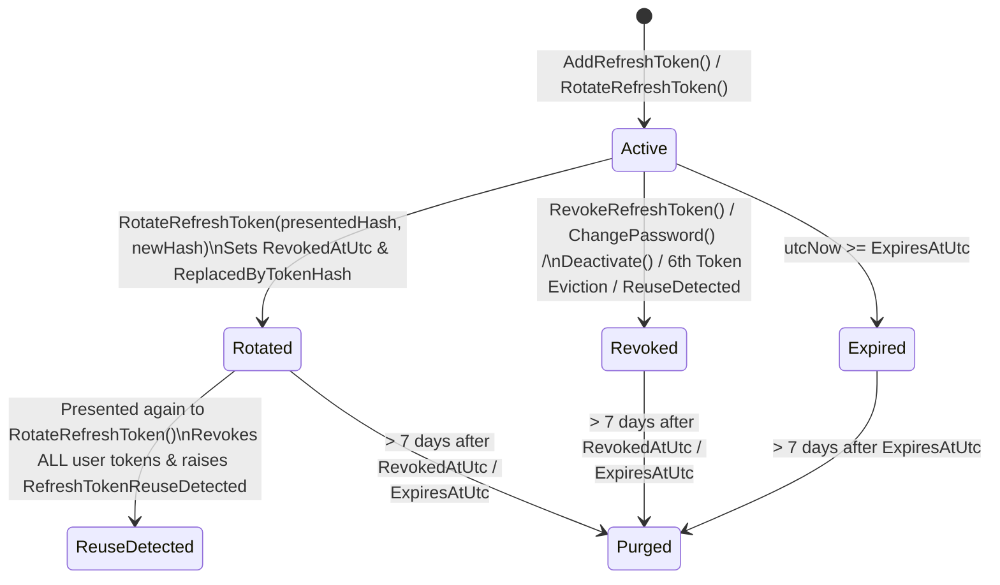
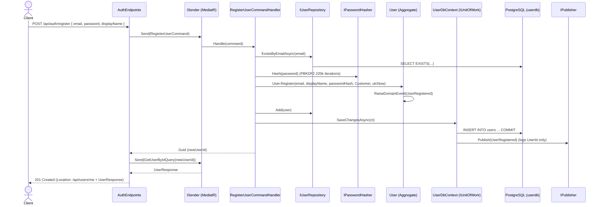
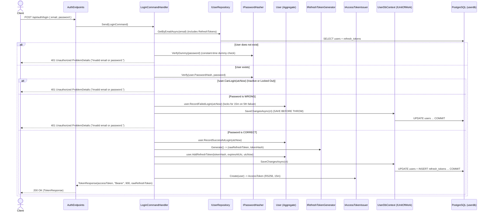
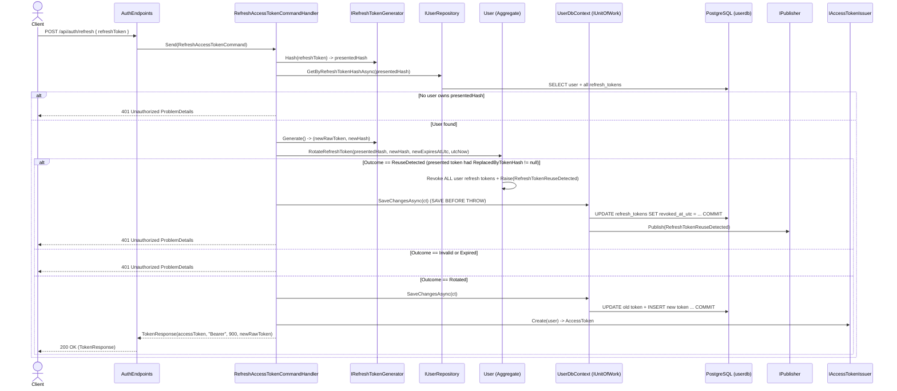
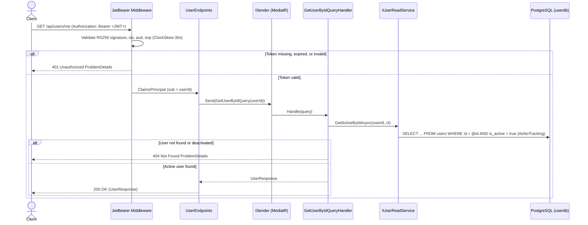

# UserService — DDD (Aggregate Root + Child Entity), CQRS, MediatR & JWT Design Document

## 1. Service Responsibilities, Bounded Context & Ubiquitous Language

### Bounded Context: Identity
**UserService** (Service #2 of the E-Commerce microservices system) is an independent microservice that owns the **Identity** bounded context.

- **What UserService Owns**: User accounts (`Id`, `Email`, `DisplayName`, `Role`, `IsActive`, `CreatedAtUtc`, `UpdatedAtUtc`, `LastLoginAtUtc`), credentials (`PasswordHash`), brute-force lockout state (`FailedLoginCount`, `LockedOutUntilUtc`), and session continuation credentials (`RefreshToken` child entities), stored in its private PostgreSQL 17 database (`userdb`).
- **What UserService Does NOT Own**: Customer shipping/billing addresses, shopping carts, product catalog (`ProductService`), inventory, orders (`OrderService`), or payments.
- **How Other Services Interact with UserService**: Other services and the API Gateway **never** call `UserService` on every HTTP request to validate tokens. Instead, `UserService` signs short-lived JWT access tokens using an **RS256** private key and publishes the corresponding public key at `GET /.well-known/jwks.json` (JWKS). Downstream services validate JWTs locally using that public key and refer to a user only by `UserId` (the `sub` claim).

### Glossary of the Ubiquitous Language
We use these exact terms in domain code, application handlers, API contracts, and documentation:

| Term | Meaning in the Identity Bounded Context |
| :--- | :--- |
| **User** | The aggregate root representing an identity account in the system. |
| **Email** | Value object representing a normalized (trimmed, lowercase, max 254 chars) unique email address. |
| **DisplayName** | The user's human-readable name (required, trimmed, max 100 chars). |
| **Role** | The user's authorization role (`UserRole` enum: `Customer` or `Admin`). |
| **Register** | Creating a new `User` account (`User.Register`). Public registration always creates a `Customer`. |
| **Login** | Authenticating with `Email` and password to receive a short-lived JWT access token and a `RefreshToken`. |
| **RefreshToken** | A child entity owned by `User` storing the SHA-256 hash (`TokenHash`) of a long-lived token used to obtain a new token pair. |
| **Rotate** | Exchanging a valid `RefreshToken` for a brand-new `RefreshToken` while revoking the presented one (`User.RotateRefreshToken`). |
| **Revoke** | Marking one or all `RefreshToken` child entities as no longer usable (`RevokedAtUtc` set). |
| **LockOut** | Temporarily blocking login for 15 minutes after 5 consecutive failed password attempts (`User.RecordFailedLogin`). |
| **ChangePassword** | Replacing `PasswordHash` on an active `User` and revoking all of their active `RefreshToken`s (`User.ChangePassword`). |
| **Deactivate** | Administratively disabling a user (`IsActive = false`) and revoking all of their active `RefreshToken`s (`User.Deactivate`). |
| **Activate** | Re-enabling an inactive user (`IsActive = true`) (`User.Activate`). |

---

## 2. Aggregate Design (`User` Aggregate Root + `RefreshToken` Child Entity)

### Aggregate Boundary
- **One `User` + its `RefreshToken` collection = One Aggregate = One Transactional Consistency Boundary.**
- `User` is the **Aggregate Root**; `RefreshToken` is a **Child Entity** (`RefreshToken : Entity`).
- Outside code (`Application`, `Infrastructure`, `Api`) can never instantiate, mutate, or save a `RefreshToken` directly. There is no `IRefreshTokenRepository`.
- `IUserRepository` always loads the `User` together with its `RefreshTokens` collection (`Include(u => u.RefreshTokens)`), and `IUnitOfWork.SaveChangesAsync` persists changes to both the `users` row and `refresh_tokens` rows atomically in a single transaction.

### Aggregate Root State: `User` (All Setters Private)
| Property | C# Type | Notes |
| :--- | :--- | :--- |
| `Id` | `Guid` | Created via `Guid.CreateVersion7(utcNow)`. |
| `Email` | `Email` (Value Object) | Required, trimmed, lowercase, max 254 chars, unique across all users. |
| `DisplayName` | `string` | Required, trimmed, max 100 chars. |
| `PasswordHash` | `PasswordHash` (Value Object) | Required opaque hash string. The Domain **never** sees a raw password. |
| `Role` | `UserRole` (Enum) | `Customer = 0` or `Admin = 1`. |
| `IsActive` | `bool` | `true` when registered; changed only by `Deactivate` and `Activate`. |
| `FailedLoginCount` | `int` | Consecutive failed password attempts (`0..4`). Resets to `0` on lockout or successful login. |
| `LockedOutUntilUtc` | `DateTimeOffset?` | When non-null and `> utcNow`, user is locked out and cannot log in. |
| `LastLoginAtUtc` | `DateTimeOffset?` | Timestamp of the most recent successful login. |
| `CreatedAtUtc` | `DateTimeOffset` | Set on `User.Register`. |
| `UpdatedAtUtc` | `DateTimeOffset` | Updated on every state change using caller-supplied `utcNow`. |
| `Version` | `uint` | Mapped to PostgreSQL system column `xmin` as the optimistic concurrency token. |
| `RefreshTokens` | `IReadOnlyCollection<RefreshToken>` | Read-only wrapper around private `List<RefreshToken> _refreshTokens`. |

### Child Entity State: `RefreshToken` (Internal Constructors & Mutators)
| Property | C# Type | Notes |
| :--- | :--- | :--- |
| `Id` | `Guid` | Created via `Guid.CreateVersion7(utcNow)`. |
| `UserId` | `Guid` | Foreign key to owning `User.Id`. |
| `TokenHash` | `string` | Required, 64-char hex/base64 SHA-256 hash of the raw refresh token. Raw token is never stored. |
| `CreatedAtUtc` | `DateTimeOffset` | When the token was issued. |
| `ExpiresAtUtc` | `DateTimeOffset` | When the token expires (`CreatedAtUtc + 7 days`). |
| `RevokedAtUtc` | `DateTimeOffset?` | Set when revoked by logout, rotation, password change, deactivation, or reuse detection. |
| `ReplacedByTokenHash` | `string?` | Set only when this token was rotated into a newer token (`RotateRefreshToken`). |

**Computed helper properties on `RefreshToken`:**
- `bool IsRevoked => RevokedAtUtc.HasValue;`
- `bool IsExpired(DateTimeOffset utcNow) => utcNow >= ExpiresAtUtc;`
- `bool IsActive(DateTimeOffset utcNow) => !IsRevoked && !IsExpired(utcNow);`

### State Diagram of a Single `RefreshToken`


### Aggregate Behaviors (Public Methods on `User`)
1. `static User Register(Email email, string displayName, PasswordHash passwordHash, UserRole role, DateTimeOffset utcNow)`
   - Validates `displayName`, creates active `User` (`IsActive = true`, `FailedLoginCount = 0`), and raises `UserRegistered(Id, email.Value, DisplayName, utcNow)`.
2. `bool CanLogin(DateTimeOffset utcNow)`
   - Returns `IsActive && (!LockedOutUntilUtc.HasValue || LockedOutUntilUtc.Value <= utcNow)`.
3. `void RecordFailedLogin(DateTimeOffset utcNow)`
   - If a previous lockout has expired (`LockedOutUntilUtc.HasValue && LockedOutUntilUtc.Value <= utcNow`), clears `LockedOutUntilUtc = null` and resets `FailedLoginCount = 0` before counting.
   - Increments `FailedLoginCount++`.
   - When `FailedLoginCount >= 5`: sets `LockedOutUntilUtc = utcNow.AddMinutes(15)`, resets `FailedLoginCount = 0`, and raises `UserLockedOut(Id, LockedOutUntilUtc.Value, utcNow)`.
   - Updates `UpdatedAtUtc = utcNow`.
4. `void RecordSuccessfulLogin(DateTimeOffset utcNow)`
   - Sets `FailedLoginCount = 0`, `LockedOutUntilUtc = null`, `LastLoginAtUtc = utcNow`, and `UpdatedAtUtc = utcNow`.
5. `void AddRefreshToken(string tokenHash, DateTimeOffset expiresAtUtc, DateTimeOffset utcNow)`
   - Validates `tokenHash` is not empty and `expiresAtUtc > utcNow`.
   - Purges old tokens from `_refreshTokens` that expired or were revoked more than 7 days before `utcNow`.
   - Enforces the **max 5 active refresh tokens** rule: while active tokens count `>= 5`, revokes the oldest active token (ordered by `CreatedAtUtc` ascending).
   - Appends the new `RefreshToken` and updates `UpdatedAtUtc = utcNow`.
6. `RefreshOutcome RotateRefreshToken(string presentedHash, string newHash, DateTimeOffset newExpiresAtUtc, DateTimeOffset utcNow)`
   - Returns `RefreshOutcome` (`Rotated`, `Invalid`, `Expired`, `ReuseDetected`) **without throwing** so `ReuseDetected` revocations can be committed before returning `401`:
     1. Token not found in `_refreshTokens` $\rightarrow$ returns `RefreshOutcome.Invalid` (no state change).
     2. Token has `ReplacedByTokenHash is not null` (already rotated earlier!) $\rightarrow$ **token theft / replay suspected**: revokes **ALL** active tokens in `_refreshTokens`, updates `UpdatedAtUtc = utcNow`, raises `RefreshTokenReuseDetected(Id, utcNow)`, and returns `RefreshOutcome.ReuseDetected`.
     3. Token has `RevokedAtUtc.HasValue` OR `!IsActive` $\rightarrow$ returns `RefreshOutcome.Invalid` (no state change).
     4. Token is expired (`utcNow >= token.ExpiresAtUtc`) $\rightarrow$ returns `RefreshOutcome.Expired` (no state change).
     5. Otherwise: marks presented token as revoked (`RevokedAtUtc = utcNow`) and replaced (`ReplacedByTokenHash = newHash`), calls `AddRefreshToken(newHash, newExpiresAtUtc, utcNow)`, and returns `RefreshOutcome.Rotated`.
7. `void RevokeRefreshToken(string tokenHash, DateTimeOffset utcNow)`
   - Idempotent: if a matching active token exists, sets `RevokedAtUtc = utcNow` and updates `UpdatedAtUtc = utcNow`. If unknown or already revoked, does nothing.
8. `void ChangePassword(PasswordHash newPasswordHash, DateTimeOffset utcNow)`
   - If `!IsActive`, throws `DomainException("Cannot change password of an inactive user.", "user.inactive")`.
   - Replaces `PasswordHash = newPasswordHash`, revokes **ALL** active refresh tokens, updates `UpdatedAtUtc = utcNow`, and raises `PasswordChanged(Id, utcNow)`.
9. `void Deactivate(DateTimeOffset utcNow)`
   - Idempotent: if `!IsActive`, does nothing. Otherwise sets `IsActive = false`, revokes **ALL** active refresh tokens, updates `UpdatedAtUtc = utcNow`, and raises `UserDeactivated(Id, utcNow)`.
10. `void Activate(DateTimeOffset utcNow)`
    - Idempotent: if `IsActive`, does nothing. Otherwise sets `IsActive = true`, updates `UpdatedAtUtc = utcNow`, and raises `UserActivated(Id, utcNow)`.

### Invariants Table

| Rule / Invariant | Where Checked | Error Code / Outcome |
| :--- | :--- | :--- |
| `Email` is not empty or whitespace | `Email.Create` + FluentValidation | `DomainException` (`email.empty`) |
| `Email` length <= 254 after trim | `Email.Create` + FluentValidation | `DomainException` (`email.too_long`) |
| `Email` has exactly one `@`, text before and after, no spaces | `Email.Create` + FluentValidation | `DomainException` (`email.invalid_format`) |
| `PasswordHash` is not empty or whitespace | `PasswordHash.Create` | `DomainException` (`password_hash.empty`) |
| Raw `Password` length is 10..128 characters (never trimmed) | FluentValidation (`Register`, `ChangePassword`) | `ValidationException` (HTTP 400) |
| `DisplayName` is not empty or whitespace | `User` + FluentValidation | `DomainException` (`user.display_name_required`) |
| `DisplayName` length <= 100 after trim | `User` + FluentValidation | `DomainException` (`user.display_name_too_long`) |
| Inactive user cannot change password | `User.ChangePassword` | `DomainException` (`user.inactive`, HTTP 422) |
| At most 5 active `RefreshToken`s per `User` | `User.AddRefreshToken` | Oldest active token automatically revoked |
| 5 consecutive failed logins lock user for 15 minutes | `User.RecordFailedLogin` | `LockedOutUntilUtc = utcNow + 15m`, raises `UserLockedOut` |
| Reused (already-rotated) refresh token revokes all user tokens | `User.RotateRefreshToken` | Returns `RefreshOutcome.ReuseDetected`, raises `RefreshTokenReuseDetected` |
| `Email` is unique across all users | `RegisterUserCommandHandler` + DB Unique Index (`23505`) | `ConflictException` (HTTP 409) |

---

## 3. The Token Contract (JWT & JWKS)

The API Gateway and downstream microservices (`OrderService`, etc.) rely on this exact token contract to authenticate and authorize requests without calling `UserService` per request.

### JWT Parameters & Endpoints
| Parameter | Value / Configuration Key | Notes |
| :--- | :--- | :--- |
| **Algorithm (`alg`)** | `RS256` (RSA PKCS#1 v1.5 with SHA-256) | Asymmetric 2048-bit RSA key pair |
| **Key ID (`kid`)** | Deterministic SHA-256 thumbprint of the RSA public key | Included in JWT header and JWKS entry |
| **Issuer (`iss`)** | `"ecommerce.userservice"` (`Jwt:Issuer`) | Validated by all services |
| **Audience (`aud`)** | `"ecommerce.api"` (`Jwt:Audience`) | Validated by all services |
| **Access Token Lifetime** | `15 minutes` (`900 seconds`, `Jwt:AccessTokenMinutes`) | Short-lived; cannot be revoked before expiry |
| **Refresh Token Lifetime** | `7 days` (`Jwt:RefreshTokenDays`) | 32 random bytes, base64url encoded; SHA-256 stored in DB |
| **Clock Skew** | `30 seconds` | Tolerates minor clock drift between containers |
| **JWKS Endpoint** | `GET /.well-known/jwks.json` | Publishes only the public RSA key (`kty`, `use: "sig"`, `alg: "RS256"`, `kid`, `n`, `e`) |

### JWT Claims Table (Exact Claim Names — No .NET Long URI Remapping)
We set `MapInboundClaims = false` on `JwtBearerOptions` and create tokens with `JsonWebTokenHandler` so claim names stay standard:

| Claim Name | Type | Example Value | Purpose |
| :--- | :--- | :--- | :--- |
| `sub` | `string` (UUID) | `"0196ed70-5a2c-7b6a-9870-123456789abc"` | `User.Id` — the sole user identifier used by other microservices |
| `email` | `string` | `"alice@example.com"` | Normalized user email |
| `role` | `string` | `"Customer"` or `"Admin"` | Used by `"AdminOnly"` authorization policy |
| `jti` | `string` (UUID) | `"0196ed75-1111-7abc-8000-abcdef123456"` | Unique identifier for this specific access token |
| `iat` | `NumericDate` | `1760821200` | Issued-at UTC epoch seconds |
| `exp` | `NumericDate` | `1760822100` | Expiration UTC epoch seconds (`iat + 900`) |
| `iss` | `string` | `"ecommerce.userservice"` | Token issuer |
| `aud` | `string` | `"ecommerce.api"` | Token audience |

### How `kid` + JWKS Enables Key Rotation Later
Each JWT header carries `"kid": "<key-id>"`, and `GET /.well-known/jwks.json` returns a `"keys": [ ... ]` array where each public key has its `"kid"`. When we rotate signing keys in the future, `UserService` can publish **both** the old public key and the new public key in `/.well-known/jwks.json` while signing new tokens with the new private key. Downstream services match the token's `kid` against the JWKS array, so tokens signed with the previous key remain valid for their remaining 15-minute lifetime with zero downtime.

---

## 4. Security Design: Threat -> Defense Matrix & Known Limitations

### Threat -> Defense Matrix
| Threat | Defense in `UserService` |
| :--- | :--- |
| **Brute-Force Password Guessing** | 1. Per-IP fixed-window rate limiter on `/api/auth/*` (`10 requests / minute -> 429 ProblemDetails`).<br>2. Aggregate-level lockout: 5 failed password attempts lock the `User` for 15 minutes (`LockedOutUntilUtc`). |
| **User Enumeration on Login** | Every login failure (unknown email, wrong password, locked out, or inactive user) returns the **exact same** `401 Unauthorized` ProblemDetails (`"Invalid email or password."`). The specific cause is logged server-side only (by `UserId`, never email/password). |
| **Timing Attacks on Login** | `LoginCommandHandler` **always** executes exactly one PBKDF2 password verification before branching: against the user's real `PasswordHash` if found, or against a pre-computed dummy hash (generated once at startup with the same iteration count) if the email does not exist. |
| **Refresh Token Theft / Replay** | Refresh tokens are rotated on every use (`RotateRefreshToken`). If an already-rotated token (`ReplacedByTokenHash != null`) is presented again, `UserService` assumes token theft, revokes **all** refresh tokens for that user, saves the revocation before throwing `401`, and raises `RefreshTokenReuseDetected` (RFC 9700). |
| **Stolen Database Dump** | 1. Passwords are never stored in plain text; they are hashed with `PasswordHasher<User>` (PBKDF2-HMAC-SHA512) using `>= 220,000` iterations (`Security:PasswordHashIterations`).<br>2. Refresh tokens are never stored in plain text; only their unkeyed SHA-256 hash (`TokenHash`) is stored (safe because raw tokens have 256 bits of cryptographic entropy). |
| **Leaked Application Logs** | 1. `LoggingBehavior` logs only the MediatR request class name and duration, never request bodies.<br>2. Domain event handlers and auth logs log `UserId` only — never emails, raw passwords, password hashes, access tokens, or refresh tokens. |
| **Signing Key Leak / Missing Key** | 1. RS256 asymmetric cryptography means only `UserService` holds the private key; other services only read the public key from `/.well-known/jwks.json`.<br>2. `.keys/` and `.env` are in `.gitignore`.<br>3. Outside `Development`, `SigningKeyProvider` **fails fast at startup** if `Jwt:PrivateKeyPath` is missing. |

> [!NOTE]
> **Password Hashing Algorithm Note (OWASP)**: OWASP Password Storage Cheat Sheet lists **Argon2id** as the primary recommendation, followed by **PBKDF2-HMAC-SHA512** with at least `210,000` iterations (`UserService` uses `220,000` by default). Because password hashing is hidden behind the `IPasswordHasher` port in `UserService.Application`, we can swap the Infrastructure implementation from `PasswordHasher<T>` to Argon2id later without touching a single line of Domain or Application code.

### Known Limitations (Intentional for This Phase — Documented, Not Fixed Now)
1. **Stateless Access Token Revocation Delay (Max 15 Minutes)**: Because JWT access tokens are validated statelessly by downstream services using the JWKS public key, a role change or `Deactivate` takes full effect across the system once the current 15-minute access token expires (immediate on `/api/users/me` and `/api/auth/refresh` because `UserService` checks `IsActive` in the database).
2. **Parallel Refresh Calls with the Same Token**: If a client sends two concurrent `/api/auth/refresh` requests with the exact same refresh token, the first rotates the token and the second either hits an `xmin` concurrency conflict (`409`) or triggers reuse detection (`401`) and revokes the session. Clients must serialize token refresh calls.
3. **Registration Reveals Email Existence (`409 Conflict`)**: `POST /api/auth/register` returns `409 Conflict` when an email is already registered. Avoiding this would require an out-of-band email verification flow.
4. **No Email Confirmation or Password Reset by Email**: Out of scope until `NotificationService` and RabbitMQ are built.
5. **Refresh Token Returned in JSON Body**: Returned in `TokenResponse` JSON for API/mobile/CLI simplicity. A browser SPA in production would store the refresh token in an `HttpOnly; Secure; SameSite=Strict` cookie.
6. **Per-IP Rate Limiting Behind an API Gateway**: The `/api/auth/*` rate limiter keys by `HttpContext.Connection.RemoteIpAddress`. When we place `UserService` behind an API Gateway / reverse proxy later, we will configure `UseForwardedHeaders` (`X-Forwarded-For`) from trusted proxies so all clients do not share the gateway's IP bucket.

---

## 5. Database Schema (`userdb`)

### Table 1: `users`
| Column | PostgreSQL Type | Nullable | Default | Constraints & Mapping |
| :--- | :--- | :--- | :--- | :--- |
| `id` | `uuid` | `NOT NULL` | — | Primary Key (`PK_users`), `ValueGeneratedNever()` |
| `email` | `character varying(254)` | `NOT NULL` | — | Mapped from `Email.Value`, Unique Index (`IX_users_email`) |
| `display_name` | `character varying(100)` | `NOT NULL` | — | Max length 100 |
| `password_hash` | `character varying(512)` | `NOT NULL` | — | Mapped from `PasswordHash.Value` |
| `role` | `character varying(32)` | `NOT NULL` | — | Enum stored as string (`"Customer"`, `"Admin"`) |
| `is_active` | `boolean` | `NOT NULL` | `true` | Active flag |
| `failed_login_count` | `integer` | `NOT NULL` | `0` | Consecutive failed login counter |
| `locked_out_until_utc` | `timestamp with time zone` | `NULL` | — | Lockout expiration UTC |
| `last_login_at_utc` | `timestamp with time zone` | `NULL` | — | Last successful login UTC |
| `created_at_utc` | `timestamp with time zone` | `NOT NULL` | — | Creation timestamp UTC |
| `updated_at_utc` | `timestamp with time zone` | `NOT NULL` | — | Last update timestamp UTC |
| `xmin` | `xid` (system column) | `NOT NULL` | Postgres internal | **Optimistic concurrency token** (`IsRowVersion()`) |

### Table 2: `refresh_tokens`
| Column | PostgreSQL Type | Nullable | Default | Constraints & Mapping |
| :--- | :--- | :--- | :--- | :--- |
| `id` | `uuid` | `NOT NULL` | — | Primary Key (`PK_refresh_tokens`), `ValueGeneratedNever()` |
| `user_id` | `uuid` | `NOT NULL` | — | Foreign Key to `users(id)` `ON DELETE CASCADE`, Index (`IX_refresh_tokens_user_id`) |
| `token_hash` | `character varying(128)` | `NOT NULL` | — | SHA-256 hash of raw token, Unique Index (`IX_refresh_tokens_token_hash`) |
| `created_at_utc` | `timestamp with time zone` | `NOT NULL` | — | Issued timestamp UTC |
| `expires_at_utc` | `timestamp with time zone` | `NOT NULL` | — | Expiration timestamp UTC |
| `revoked_at_utc` | `timestamp with time zone` | `NULL` | — | Revocation timestamp UTC |
| `replaced_by_token_hash` | `character varying(128)` | `NULL` | — | Hash of the replacement token when rotated |

**Indexes & Constraints Summary:**
- `PK_users` on `users(id)`
- `IX_users_email` UNIQUE btree index on `users(email)`
- `PK_refresh_tokens` on `refresh_tokens(id)`
- `IX_refresh_tokens_token_hash` UNIQUE btree index on `refresh_tokens(token_hash)`
- `IX_refresh_tokens_user_id` btree index on `refresh_tokens(user_id)`
- `FK_refresh_tokens_users_user_id` FOREIGN KEY `(user_id)` REFERENCES `users(id)` `ON DELETE CASCADE`
- `DomainEvents` on `AggregateRoot` is ignored by EF Core (`builder.Ignore(u => u.DomainEvents)`).

---

## 6. Command and Query Catalog (CQRS) & The "Save Before Throw" Rule

### The "Save Before Throw" Rule
In two security-critical flows, the command handler **must call `await unitOfWork.SaveChangesAsync(cancellationToken)` BEFORE throwing `UnauthorizedException`**:
1. **Failed Password on Login (`LoginCommandHandler`)**: When a user enters a wrong password, `user.RecordFailedLogin(utcNow)` increments `FailedLoginCount` (and locks the account on the 5th failure). If the handler threw `UnauthorizedException` without saving first, `FailedLoginCount` would never be persisted and brute-force lockout would never trigger.
2. **Refresh Token Reuse Detection (`RefreshAccessTokenCommandHandler`)**: When an attacker or client replays an already-rotated refresh token, `user.RotateRefreshToken(...)` revokes **all** active refresh tokens for that user, raises `RefreshTokenReuseDetected`, and returns `RefreshOutcome.ReuseDetected`. The handler must call `SaveChangesAsync` first (persisting the revocations and publishing `RefreshTokenReuseDetected`) and only then throw `UnauthorizedException`.

### Message Catalog

| Message | Type | Caller | Input Fields | Output | Validator Rules (FluentValidation) | Aggregate / Port Called | Possible Errors | HTTP Endpoint |
| :--- | :--- | :--- | :--- | :--- | :--- | :--- | :--- | :--- |
| **`RegisterUserCommand`** | Command | Anonymous | `Email`, `Password`, `DisplayName` | `Guid` (`UserId`) | `Email` required, <=254, valid format; `Password` required, length 10..128 (untrimmed); `DisplayName` required, trimmed <=100 | `ExistsByEmailAsync`, `IPasswordHasher.Hash`, `User.Register`, `Add`, `SaveChangesAsync` | `400`, `409` (email exists), `422`, `429` | `POST /api/auth/register` |
| **`LoginCommand`** | Command | Anonymous | `Email`, `Password` | `TokenResponse` | `Email` required, <=254; `Password` required, not empty | `GetByEmailAsync`, `IPasswordHasher.Verify` (or `VerifyDummy`), `CanLogin`, `RecordFailedLogin` / `RecordSuccessfulLogin`, `IRefreshTokenGenerator.Generate`, `AddRefreshToken`, `SaveChangesAsync`, `IAccessTokenIssuer.Create` | `400`, `401` (identical for all auth failures), `429` | `POST /api/auth/login` |
| **`RefreshAccessTokenCommand`** | Command | Anonymous | `RefreshToken` | `TokenResponse` | `RefreshToken` required, not empty | `IRefreshTokenGenerator.Hash` + `Generate`, `GetByRefreshTokenHashAsync`, `user.RotateRefreshToken`, `SaveChangesAsync`, `IAccessTokenIssuer.Create` | `400`, `401` (`Invalid`, `Expired`, `ReuseDetected`), `409` (concurrency), `429` | `POST /api/auth/refresh` |
| **`LogoutCommand`** | Command | Anonymous | `RefreshToken` | `Unit` | `RefreshToken` required, not empty | `IRefreshTokenGenerator.Hash`, `GetByRefreshTokenHashAsync`, `user.RevokeRefreshToken`, `SaveChangesAsync` | `400`, `429` (always `204` even if token unknown) | `POST /api/auth/logout` |
| **`ChangePasswordCommand`** | Command | Authenticated (`sub` claim) | `UserId`, `CurrentPassword`, `NewPassword` | `Unit` | `UserId` not empty; `CurrentPassword` not empty; `NewPassword` length 10..128 | `GetByIdAsync`, `IPasswordHasher.Verify` (if false $\rightarrow$ `ValidationException` on `currentPassword`), `IPasswordHasher.Hash`, `user.ChangePassword`, `SaveChangesAsync` | `400` (invalid shape or wrong `currentPassword`), `401`, `409` (concurrency), `422` (`user.inactive`) | `POST /api/auth/change-password` |
| **`DeactivateUserCommand`** | Command | `AdminOnly` | `UserId` | `Unit` | `UserId` not empty | `GetByIdAsync`, `user.Deactivate(utcNow)`, `SaveChangesAsync` | `400`, `401`, `403`, `404` | `POST /api/users/{id}/deactivate` |
| **`ActivateUserCommand`** | Command | `AdminOnly` | `UserId` | `Unit` | `UserId` not empty | `GetByIdAsync`, `user.Activate(utcNow)`, `SaveChangesAsync` | `400`, `401`, `403`, `404` | `POST /api/users/{id}/activate` |
| **`GetUserByIdQuery`** | Query | Authenticated (`sub` claim) | `UserId` | `UserResponse` | `UserId` not empty | `IUserReadService.GetActiveByIdAsync(userId)` | `401`, `404` (missing or inactive) | `GET /api/users/me` |
| **`ListUsersQuery`** | Query | `AdminOnly` | `Search`, `Role`, `IsActive`, `SortBy`, `SortDir`, `Page`, `PageSize` | `PagedResponse<UserResponse>` | `Page >= 1`; `PageSize` 1..100; `Role` in `Customer\|Admin` (when set); `SortBy` in `email\|displayName\|createdAt`; `SortDir` in `asc\|desc` | `IUserReadService.ListAsync(query)` | `400`, `401`, `403` | `GET /api/users` |

---

## 7. Sequence Diagrams

### 7.1 Register (`POST /api/auth/register`)


### 7.2 Login — Success & Failure Paths (`POST /api/auth/login`)


### 7.3 Refresh Access Token — Rotation & Reuse Detection (`POST /api/auth/refresh`)


### 7.4 Protected Endpoint Call (`GET /api/users/me`)


---

## 8. API Contract & JSON Examples

### Endpoint Summary Table
| Method | Path | Auth Policy | Rate Limit | Success | Error Statuses |
| :--- | :--- | :--- | :--- | :--- | :--- |
| `POST` | `/api/auth/register` | Anonymous | `auth` (`10/min/IP`) | `201 Created` + `UserResponse` | `400`, `409`, `422`, `429` |
| `POST` | `/api/auth/login` | Anonymous | `auth` (`10/min/IP`) | `200 OK` + `TokenResponse` | `400`, `401`, `429` |
| `POST` | `/api/auth/refresh` | Anonymous | `auth` (`10/min/IP`) | `200 OK` + `TokenResponse` | `400`, `401`, `409`, `429` |
| `POST` | `/api/auth/logout` | Anonymous | `auth` (`10/min/IP`) | `204 No Content` | `400`, `429` |
| `POST` | `/api/auth/change-password` | Authenticated | — | `204 No Content` | `400`, `401`, `409`, `422` |
| `GET` | `/api/users/me` | Authenticated | — | `200 OK` + `UserResponse` | `401`, `404` |
| `GET` | `/api/users` | `AdminOnly` | — | `200 OK` + `PagedResponse<UserResponse>` | `400`, `401`, `403` |
| `POST` | `/api/users/{id}/deactivate` | `AdminOnly` | — | `204 No Content` (idempotent) | `401`, `403`, `404` |
| `POST` | `/api/users/{id}/activate` | `AdminOnly` | — | `204 No Content` (idempotent) | `401`, `403`, `404` |
| `GET` | `/.well-known/jwks.json` | Anonymous | — | `200 OK` + JWKS JSON | — |
| `GET` | `/health/live` | Anonymous | — | `200 OK` | — |
| `GET` | `/health/ready` | Anonymous | — | `200 OK` | `503` |

### JSON Payload Examples

#### `UserResponse` (`201 Created` on `/api/auth/register`, `200 OK` on `/api/users/me`)
```json
{
  "id": "0196ed70-5a2c-7b6a-9870-123456789abc",
  "email": "alice@example.com",
  "displayName": "Alice Johnson",
  "role": "Customer",
  "isActive": true,
  "createdAtUtc": "2026-10-19T00:00:00Z",
  "lastLoginAtUtc": null
}
```

#### `TokenResponse` (`200 OK` on `/api/auth/login` and `/api/auth/refresh`)
```json
{
  "accessToken": "eyJhbGciOiJSUzI1NiIsImtpZCI6Ij...",
  "tokenType": "Bearer",
  "expiresInSeconds": 900,
  "refreshToken": "dGhpcy1pcy1hLTMtYnl0ZS1jcnlwdG8tcmFuZG9tLXRva2Vu"
}
```

#### `GET /.well-known/jwks.json` (`200 OK`)
```json
{
  "keys": [
    {
      "kty": "RSA",
      "use": "sig",
      "alg": "RS256",
      "kid": "A1B2C3D4E5F60718293A4B5C6D7E8F90",
      "n": "0vx7agoebGcQSuuPiLJXZptN9nndrQmbXEps2aiAFbWhM78LhWx4cbbfAAtVT86zwu1RK7aPFFxuhDR1L6tSoc_BJECPebWKRXjBZCiFV4n3oknjhMstn64tZ_2W-5JsGY4Hc5n9yBXArwl93lqt7_RN5w6Cf0h4QyQ5v-65YGjQR0_FDW2QvzqY368QQMicAtaSqzs8KJZgnYb9c7d0zgdAZHzu6qMQvRL5hajrn1n91CbOpbISD08qNLyrdkt-bFTWhAI4vMQFh6WeZu0fM4lFd2NcRwr3XPksINHaQ-G_xBniIqbw0Ls1jF44-csFCur-kEgU8awapJzKnqDKgw",
      "e": "AQAB"
    }
  ]
}
```

#### `401 Unauthorized` (`ProblemDetails` — Identical for All Login Failures & Unauthenticated Calls)
```json
{
  "type": "https://tools.ietf.org/html/rfc9110#section-15.5.2",
  "title": "Unauthorized",
  "status": 401,
  "detail": "Invalid email or password.",
  "instance": "/api/auth/login"
}
```

---

## 9. Solution Structure, Reference Rules, Configuration & Packages

### Folder Structure
```text
ECommerce/ (D:\MicroServess)
  docker-compose.yml          (edited to add user-service and user_keys volume)
  infra/postgres/init.sql     (already creates productdb, userdb, orderdb)
  services/ProductService/    (unchanged)
  services/UserService/
    UserService.slnx
    Directory.Build.props, Dockerfile, .dockerignore
    docs/design.md, docs/openapi.yaml
    src/UserService.Domain/
        Abstractions/   Entity.cs, AggregateRoot.cs, IDomainEvent.cs, DomainException.cs, IUnitOfWork.cs
        Users/          User.cs, RefreshToken.cs, Email.cs, PasswordHash.cs, UserRole.cs, RefreshOutcome.cs, IUserRepository.cs
                        Events/UserDomainEvents.cs
    src/UserService.Application/
        Abstractions/   ICommand.cs, IQuery.cs, ICommandHandler.cs, IQueryHandler.cs,
                        IUserReadService.cs, IPasswordHasher.cs, IAccessTokenIssuer.cs, IRefreshTokenGenerator.cs
        Behaviors/      LoggingBehavior.cs, ValidationBehavior.cs
        Exceptions/     NotFoundException.cs, ConflictException.cs, UnauthorizedException.cs
        Users/
            UserResponse.cs, TokenResponse.cs, PagedResponse.cs
            Commands/RegisterUser/, Login/, RefreshAccessToken/, Logout/, ChangePassword/, DeactivateUser/, ActivateUser/
            Queries/GetUserById/, ListUsers/
            EventHandlers/UserDomainEventHandlers.cs
    src/UserService.Infrastructure/
        Persistence/    UserDbContext.cs, UserRepository.cs, UserReadService.cs, UserDbSeeder.cs, UserDesignTimeDbContextFactory.cs
                        Configurations/UserConfiguration.cs, RefreshTokenConfiguration.cs
                        Migrations/
        Security/       PasswordHasher.cs, JwtAccessTokenIssuer.cs, RefreshTokenGenerator.cs, SigningKeyProvider.cs, SecurityOptions.cs
    src/UserService.Api/
        Program.cs, UserService.Api.http
        Endpoints/AuthEndpoints.cs, UserEndpoints.cs, JwksEndpoints.cs
        Middleware/GlobalExceptionHandler.cs, CorrelationIdMiddleware.cs
    tests/UserService.UnitTests/          (Domain/, Application/, Architecture/)
    tests/UserService.IntegrationTests/
```

### Reference Rules
- `UserService.Api` $\rightarrow$ `UserService.Application` + `UserService.Infrastructure`
- `UserService.Infrastructure` $\rightarrow$ `UserService.Application` + `UserService.Domain`
- `UserService.Application` $\rightarrow$ `UserService.Domain` (NO reference to EF Core, JWT libraries, or `Microsoft.Extensions.Identity.Core`)
- `UserService.Domain` $\rightarrow$ **nothing** (only `MediatR.Contracts`)

### Configuration Keys (`appsettings.json` / `appsettings.Development.json`)
| Key | Default / Dev Value | Validation Rule (Fail Fast at Startup) |
| :--- | :--- | :--- |
| `ConnectionStrings:UserDb` | `Host=localhost;Port=5432;Database=userdb;...` | Required, non-empty |
| `Jwt:Issuer` | `"ecommerce.userservice"` | Required, non-empty |
| `Jwt:Audience` | `"ecommerce.api"` | Required, non-empty |
| `Jwt:AccessTokenMinutes` | `15` | `1..60` |
| `Jwt:RefreshTokenDays` | `7` | `1..90` |
| `Jwt:PrivateKeyPath` | `".keys/jwt-dev.pem"` | Required; outside Development, file **must already exist** |
| `Security:PasswordHashIterations` | `220000` | `>= 1000` (220,000 in prod/dev; small in integration tests for speed) |
| `RateLimiting:AuthPermitLimit` | `10` | `>= 1` |
| `RateLimiting:AuthWindowSeconds` | `60` | `>= 1` |
| `Seed:Admin:Email` | `"admin@ecommerce.local"` (Dev only) | Valid email in Development when seeding is enabled |
| `Seed:Admin:Password` | `"AdminPass!2345"` (Dev only — marked `DEV ONLY`) | Length `10..128` |
| `Seed:Admin:DisplayName` | `"System Administrator"` | Non-empty |

### NuGet Packages per Project
| Project | NuGet Packages |
| :--- | :--- |
| `UserService.Domain` | `MediatR.Contracts` (`2.0.1` — the only package allowed in Domain) |
| `UserService.Application` | `MediatR` (**`12.5.0`** pinned), `FluentValidation`, `FluentValidation.DependencyInjectionExtensions`, `Microsoft.Extensions.Logging.Abstractions` |
| `UserService.Infrastructure` | `Microsoft.EntityFrameworkCore`, `Npgsql.EntityFrameworkCore.PostgreSQL`, `Microsoft.EntityFrameworkCore.Design`, `Microsoft.Extensions.Identity.Core` (for `PasswordHasher<T>` only), `Microsoft.IdentityModel.JsonWebTokens` |
| `UserService.Api` | `Microsoft.AspNetCore.Authentication.JwtBearer`, `Microsoft.AspNetCore.OpenApi`, `Scalar.AspNetCore`, `Microsoft.Extensions.Diagnostics.HealthChecks.EntityFrameworkCore`, `Microsoft.EntityFrameworkCore.Design` |
| `UserService.UnitTests` | `Microsoft.NET.Test.Sdk`, `xunit`, `xunit.runner.visualstudio`, `NSubstitute`, `NetArchTest.Rules`, `coverlet.collector` |
| `UserService.IntegrationTests` | `Microsoft.NET.Test.Sdk`, `xunit`, `xunit.runner.visualstudio`, `Microsoft.AspNetCore.Mvc.Testing`, `Testcontainers.PostgreSql`, `coverlet.collector` |

---

## 10. Implementation Phases & "Done When" Checks

| Phase | Description | "Done When" Check |
| :--- | :--- | :--- |
| **Phase 0** | Design (`docs/design.md` & `docs/openapi.yaml`) | Design docs are complete and approved by you. |
| **Phase 1** | Skeleton (`.slnx`, 6 projects, `Directory.Build.props`, `.gitignore`, verify `userdb`) | `dotnet build` passes and we can connect to `userdb` in PostgreSQL. |
| **Phase 2** | Domain (`User`, `RefreshToken`, `Email`, `PasswordHash`, `UserRole`, `RefreshOutcome`, events, unit tests) | `Domain` builds with only `MediatR.Contracts` and all Domain unit tests pass. |
| **Phase 3** | Application (ports, 7 commands, 2 queries, validators, behaviors, event handlers, unit tests) | Build and unit tests pass; `Application` has no EF Core, JWT, or hashing library references. |
| **Phase 4** | Infrastructure (`UserDbContext`, configurations, repositories, `PasswordHasher`, `JwtAccessTokenIssuer`, `RefreshTokenGenerator`, `SigningKeyProvider`, migration) | `users` and `refresh_tokens` tables exist in `userdb` with all columns, FK cascade, and unique indexes. |
| **Phase 5** | API (`JwtBearer`, policies, `Auth`/`Users`/`Jwks` endpoints, `GlobalExceptionHandler` with 401/403 ProblemDetails, OpenAPI + Scalar, `.http` file on port 5002) | Every request in `UserService.Api.http` returns the expected status code. |
| **Phase 6** | Operational & Security Basics (Health checks, Dev seeder, correlation ID, `/api/auth/*` rate limiter, startup options validation) | Health endpoints work, stopping DB fails `/health/ready`, and the 11th `/api/auth/*` call in 1 minute returns `429`. |
| **Phase 7** | Docker (`Dockerfile`, `.dockerignore`, add `user-service` + `user_keys` volume to `docker-compose.yml`) | `docker compose up --build` starts `postgres`, `product-service`, and `user-service`; both `:5001/health/ready` and `:5002/health/ready` return `200`. |
| **Phase 8** | Integration Tests (Testcontainers) & Architecture Tests (`NetArchTest.Rules`) | All unit, architecture, and integration tests pass via `dotnet test`. |
| **Phase 9** | Review & Wrap-up | OpenAPI matches `docs/openapi.yaml`, `README.md` is written, pattern summary + security checklist + `OrderService` prompt outline delivered. |

---

## 11. The 8 Most Important Design Decisions & Why

1. **No ASP.NET Core Identity (`UserManager`, `SignInManager`, `IdentityDbContext`)**
   - *Why*: Full ASP.NET Core Identity brings dozens of tables, anemic data models, and framework coupling that hide how authentication works and fight against DDD aggregates. By modelling `User` and `RefreshToken` ourselves and using only `PasswordHasher<T>` behind `IPasswordHasher`, our Domain stays pure and we learn every security mechanism firsthand.
2. **RS256 Asymmetric JWT with JWKS (`/.well-known/jwks.json`) Instead of a Shared Secret (`HS256`)**
   - *Why*: With `HS256`, every microservice (`ProductService`, `OrderService`, API Gateway) would need a copy of the same secret key—meaning any compromised service could forge tokens for the whole system. With `RS256`, only `UserService` holds the private key to sign tokens, while every other service verifies signatures using the public key from `/.well-known/jwks.json`.
3. **`RefreshToken` as a Child Entity Inside the `User` Aggregate Root**
   - *Why*: Security invariants like "a user can have at most 5 active refresh tokens", "changing a password revokes all refresh tokens", "deactivating a user revokes all refresh tokens", and "reusing a rotated token revokes all tokens of that user" span the user and all of their tokens. Keeping `RefreshToken` inside the `User` aggregate guarantees these rules are enforced atomically in one transaction.
4. **`LoginCommand` and `RefreshAccessTokenCommand` Return `TokenResponse` (Documented CQRS Exception)**
   - *Why*: Strict CQRS says commands return `void` or an `Id`. However, raw refresh tokens and access tokens are ephemeral secrets generated during the login/refresh state transition and are **never stored in plain text** in the database. Because a subsequent query could never read back the raw refresh token, returning `TokenResponse` directly from `LoginCommand` and `RefreshAccessTokenCommand` is the standard, secure exception to the rule.
5. **Identical `401 Unauthorized` + Constant-Time Dummy Hash Check for Every Login Failure**
   - *Why*: Returning different status codes or messages for "email not found", "wrong password", "account locked", or "account deactivated"—or skipping PBKDF2 hashing when the email does not exist—allows attackers to enumerate valid accounts via response bodies or response timing. Running `IPasswordHasher.VerifyDummy(password)` when the user is null equalizes response time.
6. **"Save Before Throw" Paired with `RefreshOutcome` for Failed Login and Token Reuse**
   - *Why*: If `RotateRefreshToken` or `RecordFailedLogin` threw an exception directly, the handler would exit before calling `IUnitOfWork.SaveChangesAsync`, rolling back the failed-login counter increment or the reuse-detection token revocations. Returning `RefreshOutcome` (`ReuseDetected`) lets the handler commit the state change to PostgreSQL first and throw `UnauthorizedException` second.
7. **Typed Exceptions (`DomainException`, `NotFoundException`, `ConflictException`, `UnauthorizedException`) Instead of a `Result<T>` Type**
   - *Why*: Keeps aggregate methods and MediatR handlers concise and consistent with `ProductService`, while `GlobalExceptionHandler` centrally maps every exception type to RFC 7807 `ProblemDetails` (`400`, `401`, `404`, `409`, `422`, `500`). Only `RotateRefreshToken` uses an outcome enum (`RefreshOutcome`) because it needs "Save before Throw".
8. **PBKDF2-HMAC-SHA512 (`>= 220,000` Iterations) Behind the `IPasswordHasher` Port**
   - *Why*: `Microsoft.Extensions.Identity.Core`'s `PasswordHasher<T>` defaults to `100,000` iterations, which is below current OWASP guidance (`210,000+` for PBKDF2-HMAC-SHA512). Raising `IterationCount` to `220,000` via configuration (`Security:PasswordHashIterations`) meets OWASP standards using audited .NET cryptography while keeping tests fast (via a lower test setting) and allowing a drop-in upgrade to Argon2id behind `IPasswordHasher` later.
